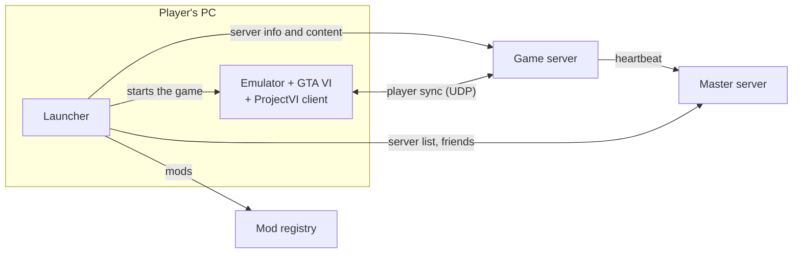

<div align="center">

# ProjectVI

**Open-source multiplayer for GTA VI on PC**

Run your own servers, script your own game modes in C#, and play the story's world together.

[](https://github.com/Tronkster/ProjectVI/actions/workflows/ci.yml)
[](https://github.com/Tronkster/ProjectVI/releases)
[](LICENSE)


</div>

> [!IMPORTANT]
> ProjectVI is an independent community project. It is not affiliated with, endorsed by or sponsored by Rockstar Games, Take-Two Interactive or Microsoft. Players need their own copy of the game. ProjectVI never ships or links to game files, encryption keys or emulators, and never connects to Rockstar's or Xbox Live's online services.

## Contents

- [Overview](#overview)
- [Features](#features)
- [Status](#status)
- [How it works](#how-it-works)
- [Getting started](#getting-started)
- [Testing without the game](#testing-without-the-game)
- [Development](#development)
- [Documentation](#documentation)
- [Roadmap](#roadmap)
- [Contributing](#contributing)
- [License](#license)

## Overview

GTA VI on PC means the Xbox Series version running through emulation, and it only has the story mode. ProjectVI adds multiplayer on top of it. Every player runs their own copy of the game; ProjectVI keeps the parts they share in step. Today that is players, vehicles, roles, chat and script events. Next come the time of day, the weather and, step by step, the story itself.

## Features

**Launcher**
- Server browser with favorites, ping, game-mode filters and search
- Friends by friend code, with online status and "join my server"
- Server content downloads, verified by checksum and shared between servers
- Public mod library: browse, install, update, and turn mods on and off
- Windows installer with automatic updates

**Game server**
- One TOML file for configuration, and resources scripted in C#
- Commands, permissions, exports, a key-value store and events across resources
- Content hosting for players' launchers, and listing on the master server

**Player sync**
- Player and vehicle state over UDP at up to 60 updates a second, interpolated on the receiving side
- Server-assigned vehicle ids, with one client simulating each vehicle and hand-over between players
- A host role, and the story's characters (Lucia and Jason) given out to players so nobody sees two of the same
- A reliable, ordered channel for chat, `/commands`, notices and script events in both directions

**Testing**
- Bots that join any server, walk, drive and chat, with a live map and simulated packet loss
- A reference client in Node and example packets for every message, for porting the client to C++

## Status

| Area | Status |
| --- | --- |
| Launcher: server browser, favorites, settings, profile | ✅ Works |
| Launcher: server content downloads | ✅ Works |
| Launcher: public mods | ✅ Works with the dev registry; the public registry isn't published yet |
| Launcher: friends, online status, join a friend's server | ✅ Works; in-game presence waits for the game client |
| Launcher: Windows installer and auto-update | ✅ Works; published on GitHub Releases |
| Launcher: optional Discord login | ❌ Discontinued |
| Master server: server list, login, favorites, friends | ✅ Works |
| Game server: config, resources, C# scripting, content hosting, listing | ✅ Works |
| Player sync: players, vehicles, host and characters | ✅ Server and reference client, tested with bots |
| Reliable messages: chat, commands, notices, script events | ✅ Server and reference client, tested at 20% packet loss |
| **Game client: joining from inside the game** | ❌ Not started. Waiting for the game to render under the emulator |

## How it works



- **The launcher** finds a server, downloads its content and the player's mods, then starts the game with the server's address.
- **The game server** owns what everyone must agree on: who is playing, who is host, which character each player is, every vehicle and who simulates it. It relays player state to whoever is near, and runs the resources' C# scripts.
- **The game client**, once it exists, reports the local player and the vehicles it simulates, and draws everyone else as characters driven by the network.

Details: [architecture](docs/architecture.md) and [protocol](docs/protocol.md).

## Getting started

You need [Node.js](https://nodejs.org) 22.13 or newer, and the [.NET 10 SDK](https://dotnet.microsoft.com/download) for C# scripting.

```sh
git clone https://github.com/Tronkster/ProjectVI.git
cd ProjectVI
npm install            # every package, including Electron
npm run build:scripting

npm run dev:master     # master server on http://localhost:30180
npm run dev:server     # a local game server with example resources
npm run dev:launcher   # the launcher
```

To use the example mods, run `npm run dev:registry`, turn on **Settings → Developer → Developer mode**, then set **Settings → Mods → Mod registry** to `http://localhost:30190/index.json`. `npm run dev:fake` adds seven pretend servers so the browser looks busy.

To host a real server, see [Hosting a server](docs/hosting-a-server.md).

## Testing without the game

Bots exercise sync the way the game client will: each one is a full client with its own connection.

```sh
npm run dev:server
npm run dev:bots -- --count 20 --view 30125 --chat 5 --loss 10
```

That joins 20 bots that walk and drive near the spawn point, chat every 5 seconds over a link that loses 10% of packets, and serves a live map of what the first bot sees on http://127.0.0.1:30125. The status line reports what each bot sees, missed updates, round trip and how much chat arrived. All options are at the top of [`server/scripts/bots.js`](server/scripts/bots.js).

## Development

| Command | What it does |
| --- | --- |
| `npm test` | Runs every test (Node and .NET) |
| `npm run lint` | Runs ESLint |
| `npm run build:scripting` | Builds the C# script host |
| `npm run dist` | Builds `launcher/dist/ProjectVI-Setup-<version>.exe` |
| `npm run capture -w launcher` | Screenshots of the main launcher screens |

```
launcher/          Electron desktop app
master-server/     Server list, friends and favorites (Node, no dependencies)
server/            Reference game server, and the bots (server/scripts/bots.js)
scripting/dotnet/  C# scripting: SDK, script host and test helpers
registry/          Public mod registry format, validator and dev registry
packages/shared/   Shared by everything: sync protocol, reference client, names, paths, content lists
packages/zip/      Safe zip reading for mods
docs/              Guides and reference
```

**Releasing:** tag a version, for example `git tag v0.5.0 && git push --tags`. The Release workflow builds the installer and publishes it on GitHub Releases, where installed launchers find it. Builds aren't code-signed yet, so Windows SmartScreen warns on first install (**More info → Run anyway**).

## Documentation

| Guide | For |
| --- | --- |
| [Architecture](docs/architecture.md) | How the pieces fit together |
| [Protocol](docs/protocol.md) | Launcher, master server and game server APIs, and player sync |
| [Hosting a server](docs/hosting-a-server.md) | Server owners |
| [Running a master server](docs/master-server.md) | Running your own server list |
| [Making mods](docs/making-mods.md) and the [mod registry](docs/registry.md) | Mod authors |
| [Client reverse engineering](docs/client-reverse-engineering.md) | Contributors working on the game client |

## Roadmap

1. **One world (milestone A).** Everyone in the same world as the story's characters, with the story switched off: player and vehicle sync, roles, chat and events are done; server time and weather, damage and join tickets are next.
2. **The game client.** A module the emulator loads beside the game, running the same protocol. Blocked until the game renders under the emulator.
3. **A shared story (milestone B).** The host's game runs the story; mission characters, vehicles and events stream to the other players, and progress comes from the host's save.

## Contributing

Pull requests are welcome. Read [CONTRIBUTING.md](CONTRIBUTING.md) and the [code of conduct](CODE_OF_CONDUCT.md) first. Report security problems privately as described in [SECURITY.md](SECURITY.md).

## License

[MIT](LICENSE). Grand Theft Auto and Grand Theft Auto VI are trademarks of Take-Two Interactive Software, Inc. Xbox is a trademark of Microsoft Corporation.
