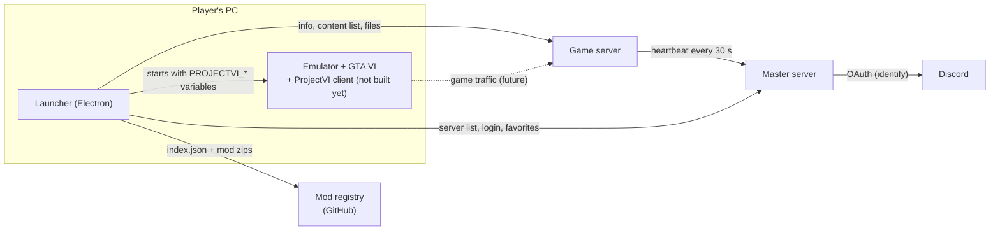

# Architecture

## Launcher

| Layer | Files | Trusts |
| --- | --- | --- |
| Main process | `launcher/src/main/*.js` | Itself only. Validates everything from the network and from the UI |
| Preload bridge | `launcher/src/preload.js` | Exposes a fixed list of calls, grouped by area |
| UI | `launcher/src/renderer/` | Nothing. Escapes every value it shows |

- The UI runs sandboxed, with context isolation and no Node. It's served from `app://launcher/` with a strict Content Security Policy.
- Every IPC call is checked to come from that origin.
- The UI only refers to servers and mods by id. Hosts, ports, URLs and file paths are looked up in the main process.
- Login tokens stay in the main process, encrypted with Windows DPAPI.
- Code that doesn't need Electron (settings, servers, launch, content, mods, auth, protocol) doesn't import it, so `node --test` covers it directly.

### Main-process modules

| Module | Job |
| --- | --- |
| `index.js` | App lifecycle, window, tray |
| `ipc.js` | Every renderer call |
| `settings.js` | Typed settings schema and store |
| `servers.js` | Master server list and pings |
| `content.js` + `http.js` | Server content checks, hashed downloads and cache |
| `mods.js` | Registry, install, update, turn on and off, remove |
| `auth.js` | Discord login through the master server |
| `launch.js` | Starts the emulator with the right arguments and environment |
| `updater.js` | Auto-update from GitHub Releases |
| `protocol.js`, `logger.js`, `files.js` | Plumbing |

## Shared rules

`packages/shared` holds the rules that both sides of a connection must agree on:
- player names
- safe relative paths
- the content list format
- the registry format

The game server builds content lists with the same validator the launcher checks them with. Registry CI uses the same mod rules as the launcher.

## Where files live on a player's PC

| Path | Contents |
| --- | --- |
| `%APPDATA%\ProjectVI\settings.json` | Settings |
| `%APPDATA%\ProjectVI\session.bin` | Login token, encrypted |
| `%APPDATA%\ProjectVI\mods\` and `mods.json` / `mods-enabled.json` | Installed mods |
| `%APPDATA%\ProjectVI\logs\launcher.log` | Log, rotated at 1 MB |
| `%LOCALAPPDATA%\ProjectVI\cache\content\` | Server content, shared by hash |
| `%LOCALAPPDATA%\ProjectVI\cache\servers\<key>\manifest.json` | Content list for the client, written on join |
